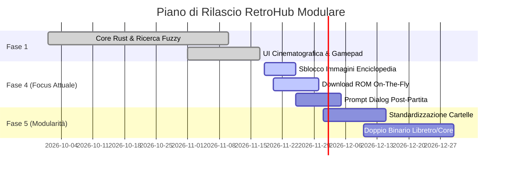

# 🗺️ RetroHub — Roadmap di Sviluppo Strategica
**Versione Roadmap:** 3.0 (Target Prioritario: Windows Produzione Immediata | Architettura a 4 Binari & Clean Rebirth UI)  
**Obiettivo:** Trasformare RetroHub nel launcher retrogaming definitivo per Windows: motore Rust a 60 FPS da soli 7 MB, enciclopedia on-demand per 200+ console, Hero Widescreen configurabile con rotazione a 5 sorgenti, 4 profili di onboarding guidato e integrazione nativa di Recomp e PC Indie/LocoMalito. *(Linux e macOS pianificati per le fasi successive al rilascio Windows).*

---

## 📌 FASE 1: Client Locale & Core Engine (Completata 🟢)
*Obiettivo: Interfaccia desktop ultra-rapida, database SQLite indicizzato e motore di ricerca avanzato.*

- [x] **Backend Rust Ultra-rapido:** Server HTTP locale integrato (`tiny_http` porta 39281), avvio istantaneo in <50ms e consumo RAM <25MB.
- [x] **Database SQLite Locale con Indici:** Tabelle `games`, `stats` e preferiti con query ottimizzate a 0ms.
- [x] **Motore di Ricerca Avanzato Multi-campo & Fuzzy:**
  - Punteggio pesato Jaro-Winkler e distanza Levenshtein.
  - Supporto per operatori booleani (esclusione `-` / `NOT`, frasi esatte tra virgolette `"..."`, OR `|`, filtri `genre:`, `dev:`, `sys:`, intervalli anni `1990..1995`).
- [x] **UI Cinematografica Dark Mode (Ispirata a Steam & RecompLauncher):**
  - Hero Spotlight Carousel con artwork panoramico e comandi gamepad.
  - Griglia poster con proporzioni boxart fisse e glow ciano.
  - Fallback tipografico elegante per titoli privi di boxart esterna.
  - Navigazione nativa da controller Xbox e adattatori USB (DirectInput / XInput).

---

## 📌 FASE 2: Arena Multiplayer P2P & Leaderboard Standardizzata (In Sviluppo 🟡)
*Obiettivo: Sfide 1 contro 1 a distanza con amici senza server intermedi e classifica globale dei record Arcade.*

- [x] **Generatore Codici Stanza:** Creazione token univoci di invito (es. `RH-7821`).
- [x] **Handshake P2P Diretto (Rete Locale / LAN):** Connessione diretta tra Host e Guest via socket UDP.
- [x] **Avvio Sincronizzato Emulatori Netplay:**
  - Parametri da riga di comando per Flycast, Snes9x, DuckStation, Dolphin e MAME.
- [ ] **Dashboard Interattiva Arena Online:**
  - Schermata grafica a schede per Creazione Stanza, Unione tramite Codice e Monitoraggio Latenza (Ping RTT in tempo reale).
- [ ] **Leaderboard Standardizzata & Hall of Fame (High Scores):**
  - Estrazione automatica punteggio record al Game Over per Arcade (MAME / Neo-Geo) e classici a punti.
  - Classifica locale offline su PC + invio sicuro alla Leaderboard Globale RetroHub del mese.
- [ ] **NAT Traversal Pubblico Reale (WAN / Internet):**
  - Integrazione resolver STUN reale (Google / Cloudflare) per bypass router senza port forwarding manuale.

---

## 📌 FASE 3: Server Lobby & Bacheca Stanze Pubbliche (Cloud Matchmaker ⚪)
*Obiettivo: Matchmaking pubblico centralizzato con bacheca "In attesa di sfidante".*

- [ ] **Microservizio di Segnalazione Remoto:** Server cloud leggero per coordinamento sessioni attive.
- [ ] **Bacheca Stanze in-App:** Schermata "Arena Online" collegata a stanze pubbliche reali con filtro per latenza e regione.

---

## 📌 FASE 4: Personalizzazione Libreria, Enciclopedia Immagini & Download ROM "On-The-Fly" (Completata 🟢)
*Obiettivo: Nessun bisogno di riempire l'hard disk con terabyte di file: consultazione visiva al 100% dell'intero catalogo e download automatico della ROM al click.*

### **4.1 Enciclopedia & Sblocco Immagini Completo per Piattaforma**
- [x] **Modalità Catalogo Completo (Zero-Disk Footprint):**
  - L'utente seleziona una console o piattaforma e può **sbloccare/sfogliare tutte le copertine e metadati al 100%**, anche se le ROM non sono ancora presenti sul PC.
  - Switch rapido in UI: `[ Mostra Tutto l'Archivio ]` vs `[ Solo Giochi Scaricati ]`.
- [x] **Risoluzione Copertine Multi-Mirror:**
  - Download asincrono boxart ad alta risoluzione da Libretro CDN, Steam CDN e screen snapshot locali.
  - Caching locale automatico in `cache/covers/` per consultazione offline.

### **4.2 Download ROM "On-The-Fly" al Click**
- [x] **Download Trasparente al Lancio:**
  - Se l'utente clicca **☁️ SCARICA & GIOCA** su un titolo non presente in locale, il client scarica la ROM "al volo" tramite `DownloadManager` con feedback visivo e notifica.
  - Caching nella cartella dedicata `downloads/`.
- [x] **Avvio Immediato Post-Download:**
  - Non appena il download termina, la ROM viene registrata come installata e l'emulatore o core di sistema si avvia istantaneamente a schermo intero.

### **4.3 Dialog Intelligente Post-Partita (Salva-Spazio)**
- [x] **Prompt di Chiusura e Gestione Spazio:**
  - Finestra di dialogo modale post-partita integrata in UI:
    ```
    🎮 Partita Conclusa!
    Cosa desideri fare con la ROM scaricata on-the-fly?
    [ 💾 TIENI SUL PC ]    [ 🗑️ ELIMINA PER FARE SPAZIO ]
    ```
  - Rimozione sicura del file scaricato via `POST /api/library/delete` con aggiornamento immediato della libreria.

### **4.4 Wizard di Onboarding & Strategie di Storage (4 Profili Utente)**
- [ ] **Wizard Iniziale Guidato (Step-by-Step):**
  - *Caso 1 (Nuovo Utente / Zero ROM):* Attivazione Top 5/10 Regina, zero download preventivo, eliminazione automatica a fine partita.
  - *Caso 2 (Collezione Locale Esistente):* Auto-Discovery su cartella radice standard (`roms/<console>/`).
  - *Caso 3 (Low Storage / Handheld):* Modalità **Placeholder Tipografici Vettoriali** (0 byte immagini a monte, boxart scaricata solo per giochi scaricati o preferiti).
  - *Caso 4 (Full Storage / 4TB+):* Download persistente e attivazione totale delle ~200 piattaforme con interruttore ON/OFF.
- [ ] **Sandbox di Test "Simula Nuovo Utente":**
  - Toggle a video per testare l'esperienza da vuoto (tutti i giochi in `☁️ ON-DEMAND`) senza cancellare o alterare un singolo file reale dal disco.

---

## 📌 FASE 5: Gestione Modulare di Emulatori & Core (Standard Batocera / RetroBat 🧩)
*Obiettivo: Adottare l'architettura modulare di Batocera e RetroBat, supportando l'intero ecosistema di oltre 200 console, arcade e computer d'epoca.*

### **5.1 Architettura Ibrida a Quattro Binari (Libretro + Standalone + PC Recomp + PC Indie & LocoMalito)**
Come Batocera e RetroBat (e con il supporto esclusivo per i port nativi PC e titoli indipendenti), la gestione dei motori di gioco viene standardizzata in quattro categorie:
1. **Piattaforme 8/16/32-bit & Computer Classici (80% dei sistemi):**
   - Gestione unificata tramite **RetroArch Libretro Cores** (es. `snes9x_libretro.dll`, `genesis_plus_gx_libretro.dll`, `fceumm_libretro.dll`, `puae_libretro.dll`, `vice_x64sc_libretro.dll`).
   - *Vantaggi:* Shader video CRT uniformi, configurazione controller centralizzata, savestate e rewind garantiti.
2. **Piattaforme 3D Complesse & Arcade Speciali (Standalone Dedicati):**
   - Esecutori dedicati ottimizzati: Dolphin (GameCube/Wii), PCSX2 (PS2), RPCS3 (PS3), DuckStation (PS1), Flycast (Dreamcast/Naomi), Model 2 Emulator, Supermodel (Model 3), Xemu (Xbox), Cemu (Wii U).
3. **PC Recompilations & Decompilazioni Native (Terzo Binario Nativo):**
   - Gestione nativa per porting PC a 60/144 FPS (*Ship of Harkinian, CannonBall OutRun, OpenGOAL, Mario 64 PC, Namco System 22, KOF '98 Recomp*).
   - Doppia visibilità: compaiono sia nella sezione "PC Recomp" che nella console originale con badge `⚡ 4K RECOMP`.
   - Verifica automatica integrità asset tramite hash SHA256 e lancio nativo diretto con supporto display Ultra-Wide.
4. **PC Indie, LocoMalito & Fan Games Nativi (Quarto Binario Nativo):**
   - Gestione integrata per 33+ capolavori Neo-Retro (*Maldita Castilla, Hydorah, AM2R, Streets of Rage Remake, Celeste, Hollow Knight, UFO 50, Cave Story, The Messenger*).
   - Codice Piattaforma `pc_indie` con tag dedicati (`#locomalito`, `#fan-remake`, `#pixel-8bit`).
   - Risoluzione intelligente del multi-EXE (ignora `unins000.exe`, `vcredist`, `dxsetup`), working directory automatica e capsule verticali Steam 600x900 CDN.
   - Doppio modello di archiviazione: On-demand istantaneo per il freeware (2-88 MB), collegamento libreria locale per i titoli commerciali.

### **5.2 Struttura Cartelle ROM Standardizzata & Manifest 200+ Piattaforme**
- **Nomenclatura Standard Universale (Multiplatform Win/Linux/Mac):**
  - Cartella radice configurabile + sottocartelle convenzionali: `roms/nes/`, `roms/snes/`, `roms/megadrive/`, `roms/psx/`, `roms/c64/`, `roms/amiga/`, `roms/mame/`, `roms/neogeo/`, ecc.
- **File Modulare `platforms_manifest.json` (200+ Piattaforme):**
  - Mappa per ciascuna console: codice, nome esteso, produttore, categoria, estensioni supportate, core predefinito, badge e colori sociali.
- **Filtri di Sottosezione Metadati (Riduzione Scheletro):**
  - Selezione per Top 50/100, edizioni in lingua italiana, generi primari o finestre temporali d'oro (`1991..1996`).

### **5.3 Wizard di Configurazione Percorsi & Auto-Discovery**
- Rilevamento automatico delle installazioni esistenti di RetroArch, Batocera mounts, o cartelle RetroBat su drive `C:`, `D:`, `E:`.
- Nessun percorso personale hardcoded: tutte le directory sono relative o configurabili da interfaccia grafica in-app.

---

## 📊 Matrice di Avanzamento e Priorità Operativa


