# 🎮 RetroHub — Report di Analisi Strategica di Progetto (v3.5)
**Ruolo:** Project Manager & Lead Architect  
**Data Aggiornamento:** 19 Novembre 2026 (Release v0.46.0)  
**Target Progetto:** `C:\Users\ClaudioDall'Ara\Desktop\Clod\MySide\launcher_game`  
**Documenti Salvati:**
- [ROADMAP.md](file:///C:/Users/ClaudioDall'Ara/Desktop/Clod/MySide/launcher_game/ROADMAP.md)
- [README.md](file:///C:/Users/ClaudioDall'Ara/Desktop/Clod/MySide/launcher_game/README.md)

---

## 📌 1. La Nuova Architettura Tassonomica (14 Macro-Famiglie)

```mermaid
flowchart TD
    subgraph RetroHub Core
        A[Sidebar Sinistra Collassabile 64px] --> B[Albero Espandibile 260px]
    end

    subgraph 14 Macro Famiglie
        B --> M1[1. 🕹️ Arcade Coin-Op: MAME, CPS, Naomi, Model 2/3, Atomiswave]
        B --> M2[2. 📀 Laserdisc & FMV: Hypseus Singe, Daphne, Action Max]
        B --> M3[3. 🎯 Pinball & Flipper: Visual Pinball X, Future Pinball]
        B --> M4[4. 📟 LCD & Game and Watch: Nintendo LCD, Tiger, Tabletop]
        B --> M5[5. 🍄 Mondo Nintendo: NES, SNES, N64, GameCube, GBA, DS]
        B --> M6[6. 🌀 Galassia SEGA: Master System, Mega Drive, Saturn, Dreamcast]
        B --> M7[7. 🎮 Sony PlayStation: PSX, PS2, PS3, PSP, Vita]
        B --> M8[8. 🦅 Atari & Pioneers: 2600, 5200, 7800, Lynx, Jaguar, Vectrex, Coleco, Intellivision]
        B --> M9[9. ⚔️ SNK & NEC Engine: Neo Geo AES/MVS/CD/Pocket, PC Engine, SuperGrafx]
        B --> M10[10. 💾 Commodore 8-Bit: C64, VIC-20, PLUS/4, C128, PET]
        B --> M11[11. 🔴 Amiga Universe: Amiga 500, Amiga 1200, CD32]
        B --> M12[12. 🖥️ PC DOS & Home Computer: MS-DOS, ScummVM, ZX Spectrum, Amstrad CPC]
        B --> M13[13. 🗾 Nippon Micro Computers: Sharp X68000, MSX/MSX2, FM Towns, PC-88/98]
        B --> M14[14. ⚡ PC Moderno, Recomp & Indie: 60FPS Recomp, Steam/Freeware Indie, PICO-8]
    end
```

---

## 🚀 2. Aggiornamenti Milestone v0.46.0

1. **Risoluzione Definitiva Avvio MAME, NAOMI e PSX:**
   - **MAME:** Ripristinato il launcher PowerShell con corretta inizializzazione del processo, working directory autonoma e focus foreground prioritario (`AppActivate`). Rimossa la forzatura di argomenti video conflittuali con display multipli.
   - **NAOMI & PSX:** Implementato il resolver ricorsivo `match_lnk_or_rom_in_dir` in `src/launcher.rs`. Risolve e avvia istantaneamente i collegamenti `.lnk` e i file `.chd`/`.zip` presenti in `C:\Users\ClaudioDall'Ara\Desktop\Clod\emu\NAOMI - Flycast\` e `C:\Users\ClaudioDall'Ara\Desktop\Clod\emu\PSX\` (es. *Lupin Sansei - The Shooting*, *Lupin Sansei PSX*, *Crash Bandicoot*, *Virtua Tennis 2*, ecc.).
   - **Pre-rilevamento Locale Istantaneo:** All'avvio del server, i giochi già presenti nella cartella `emu` vengono automaticamente contrassegnati con `is_installed: true` e target di avvio compilato, eliminando i falsi download simulati.
   - **Immunità UTF-8 BOM:** Rimosso il BOM e aggiunta la gestione difensiva con `.strip_prefix('\u{feff}')` in `src/master_catalog.rs`.

2. **Integrazione Core Pinball a 1 Clic (Zero Redirect GitHub):**
   - Aggiunti endpoint backend `POST /api/emulators/install-vpx` e `GET /api/emulators/install-status`.
   - Download in background del pacchetto standalone di Visual Pinball X, estrazione automatica tar/PowerShell e salvataggio automatico del percorso eseguibile in `RetroHubConfig`.
   - Modale dedicato con barra di avanzamento e avvio automatico del tavolo una volta terminata l'integrazione.

3. **Separazione Netta Categorie Commodore 8-Bit, Amiga e PC:**
   - **Commodore 8-Bit:** Separato con oltre 220 giochi (C64, VIC-20, PLUS/4, C128, PET).
   - **Amiga Universe:** Categoria autonoma dedicata all'architettura 16/32-bit (Amiga 500, Amiga 1200, CD32).
   - **PC & Home Computer:** MS-DOS, ScummVM, ZX Spectrum, Amstrad CPC.

4. **Nuova Toolbar OLED con Ordinamento e Decadi:**
   - **Pillole Epoca:** '70s Pioneers, '80s Golden Era, '90s 16/32-Bit, 2000+ Modern.
   - **Ordinamento Dinamico:** Per Anno (Crescente/Decrescente), Produttore/Developer, Genere, Titolo A-Z/Z-A, Score, Più Giocati e pulsante `🎲 Shuffle`.

5. **Bonifica Catalogo e Ripristino Copertine (1.679 Titoli Verificati):**
   - Rimossi 22 bios e chip audio non giocabili dall'Arcade.
   - Rimossi 32 doppioni console.
   - Verificate e mappate le copertine per Pinball, Recomp, Laserdisc, Atari Lynx, Atari 2600, Intellivision, Game & Watch, SNES e Arcade.
