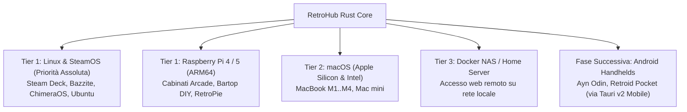

# 🌍 Specifiche Tecniche & Piano di Porting Multipiattaforma
## Linux (Desktop & SteamOS), macOS (Apple Silicon & Intel) e Raspberry Pi (ARM64)

**Progetto:** RetroHub — Client Retrogaming Nativo (Rust)  
**Versione Documento:** 1.0 (Audit di Portabilità, Astrazione Architetturale & Flusso di Test Locale)  
**Data:** 19 Novembre 2026  
**Target File:** `launcher_game/docs/ARCHITETTURA_MULTIPROGETTO_CROSS_PLATFORM.md`  

---

## 🧭 1. Visione Strategica & Obiettivo del Porting

Grazie alla scelta fondamentale di **Rust** come linguaggio di sviluppo, oltre il 95% del codice di RetroHub è già intrinsecamente multipiattaforma:
* Il database SQLite indicizzato con C bundled (`rusqlite`).
* Il motore di ricerca avanzata fuzzy e compound boolean (`strsim`, `regex`).
* Il micro-server HTTP asincrono REST (`tiny_http`).
* La gestione download on-demand e networking P2P UDP (`reqwest`, standard socket).
* L'interfaccia utente webview in HTML5/CSS3/ES2022 con controlli Gamepad API universali.

L'unico livello che richiede adattamento è il **Livello Operativo del Sistema (OS Platform Layer)**: l'apertura della finestra in modalità standalone, il lancio dei processi degli emulatori senza bloccare l'interfaccia e la gestione dei percorsi file.

---

## 🏆 2. Matrice di Portabilità e Tiering Ufficiale



| Sistema Operativo | Architettura CPU | Priorità Strategica | Meccanismo Finestra UI | Dispatching Emulatori | Stato Test |
| :--- | :---: | :---: | :--- | :--- | :---: |
| **Windows 10/11** | x86_64 | **Attivo (v0.37)** | Edge / Chrome `--app=` | Win32 `Command` (`CREATE_NO_WINDOW`) | 🟢 In Produzione |
| **Linux (Desktop & SteamOS)** | x86_64 | ⭐ **Tier 1** | Chromium / Chrome `--app=` o `xdg-open` | Binari ELF nativi, Flatpak, AppImage | 🟢 12/12 test superati (WSL2) |
| **Raspberry Pi 4 / 5** | ARM64 (`aarch64`) | ⭐ **Tier 1** | Chromium `--app=` (Raspberry Pi OS) | Binari nativi ARM64, RetroArch Libretro | 🟢 Compilabile via Docker `cross` |
| **macOS (M1..M4 & Intel)** | Universal 2 (arm64 + x86_64) | ⭐ **Tier 2** | Chrome / Brave `--app=` o `open` Safari | Bundle `.app`, Homebrew, Libretro `.dylib` | 🟡 Target CI GitHub Actions |
| **Docker / NAS Headless** | x86_64 / ARM64 | ⭐ **Tier 2** | Web Browser su rete locale (`:39281`) | Headless Catalog & Stream | 🟢 Testabile subito |
| **Android Handhelds** | ARM64 | ⏳ **Fase Futura** | WebView Android nativo (Tauri v2) | Android Intents (`Intent(ACTION_VIEW)`) | 🟠 Richiede wrapper NDK/JNI |

---

## ⚙️ 3. Workflow di Compilazione e Test Diretti su questa Macchina Windows

Uno dei maggiori vantaggi della configurazione attuale è che **la versione Linux può essere compilata e testata graficamente con audio direttamente su questo PC Windows**, senza bisogno di hardware o partizioni aggiuntive.

### 3.1 Linux & SteamOS: Collaudo Locale con WSL2 + WSLg
La macchina host dispone di:
* **WSL2 attivo con Ubuntu 24.04** e toolchain Rust `rustc 1.90.0` / `cargo`.
* **WSLg (GUI Wayland/X11 + Audio PulseAudio):** attivo su `/mnt/wslg` con socket grafici e `PulseServer`.

#### Comandi Operativi di Build & Test Linux:
1. **Compilazione del binario Linux ELF nativo:**
   ```bash
   wsl -d Ubuntu-24.04 bash -c "cd '/mnt/c/Users/ClaudioDall'Ara/Desktop/Clod/MySide/launcher_game' && cargo build --release"
   ```
2. **Esecuzione e Collaudo Grafico su Windows:**
   ```bash
   wsl -d Ubuntu-24.04 bash -c "cd '/mnt/c/Users/ClaudioDall'Ara/Desktop/Clod/MySide/launcher_game' && ./target/release/retro-hub"
   ```
   *Risultato:* La finestra grafica di RetroHub apparirà **direttamente sul desktop di Windows**, renderizzata con accelerazione grafica nativa Wayland e audio integrato!

### 3.2 Raspberry Pi 4 / 5: Compilazione ARM64 con Docker
Grazie a Docker Desktop 29.x installato sulla macchina, possiamo cross-compilare il binario per Raspberry Pi (ARM64) senza toccare l'ambiente host tramite `cross`:
```powershell
cargo install cross --git https://github.com/cross-rs/cross
cross build --target aarch64-unknown-linux-gnu --release
```
Il binario risultante in `target/aarch64-unknown-linux-gnu/release/retro-hub` è pronto per essere copiato su qualsiasi Raspberry Pi con Raspberry Pi OS.

### 3.3 macOS: Compilazione & Firma via GitHub Actions CI
A causa dei vincoli di Apple (il runtime grafico Metal/Cocoa non può essere virtualizzato su Windows e i binari privi di certificato sviluppatore vengono bloccati da Gatekeeper), la soluzione industriale consiste in un workflow GitHub Actions:
* **Runner:** `macos-14` (Apple Silicon M-Series, gratuito su GitHub per repository pubblici).
* **Compilazione Automatica:** Target `aarch64-apple-darwin` e `x86_64-apple-darwin`.
* **Assemblaggio Universale:** `lipo -create -output RetroHub target/...` per creare il binario universale.
* **Packaging:** Generazione automatica di `RetroHub-macOS.dmg` allegato ad ogni tag di release.

---

## 🧩 4. Architettura del Modulo `src/platform/`

Per mantenere il codice pulito ed eliminare direttive `#[cfg]` sparse nei sorgenti, il layer di sistema viene centralizzato in `src/platform/`:

```
src/
├── platform/
│   ├── mod.rs          // Trait comune e dispatching automatico
│   ├── windows.rs      // Edge App Mode, CREATE_NO_WINDOW, scorciatoie .lnk
│   ├── linux.rs        // Chromium App Mode / xdg-open, binari ELF, Flatpak
│   └── macos.rs        // Chrome / open Safari, App Bundle (.app), lipo
```

### 4.1 Interfaccia Astratta (`src/platform/mod.rs`)
```rust
use std::path::{Path, PathBuf};

#[cfg(target_os = "windows")]
#[path = "windows.rs"]
mod os_impl;

#[cfg(target_os = "linux")]
#[path = "linux.rs"]
mod os_impl;

#[cfg(target_os = "macos")]
#[path = "macos.rs"]
mod os_impl;

/// Apre l'interfaccia grafica webview in modalità finestra standalone
pub fn open_app_window(url: &str) {
    os_impl::open_app_window(url);
}

/// Lancia un eseguibile di emulatore o gioco in modo asincrono e distaccato
pub fn spawn_detached_process(executable: &Path, args: &[&str], working_dir: &Path) -> Result<(), String> {
    os_impl::spawn_detached_process(executable, args, working_dir)
}

/// Rileva se un file è un eseguibile supportato sul sistema corrente
pub fn is_executable(path: &Path) -> bool {
    os_impl::is_executable(path)
}

/// Apre una cartella o file con il gestore file predefinito (Explorer, Nautilus, Finder)
pub fn open_in_file_manager(path: &Path) -> Result<(), String> {
    open::that(path).map_err(|e| e.to_string())
}
```

### 4.2 Implementazione Linux & SteamOS (`src/platform/linux.rs`)
```rust
use std::path::{Path, PathBuf};
use std::process::Command;

pub fn open_app_window(url: &str) {
    // 1. Cerca browser Chromium-based per finestra standalone borderless
    let chromium_candidates = ["chromium", "google-chrome", "brave-browser", "microsoft-edge"];
    for browser in chromium_candidates {
        if which_exists(browser) {
            if Command::new(browser)
                .args([&format!("--app={}", url), "--window-size=1440,900"])
                .spawn()
                .is_ok()
            {
                return;
            }
        }
    }
    // 2. Fallback universale Freedesktop (xdg-open)
    let _ = open::that(url);
}

pub fn spawn_detached_process(executable: &Path, args: &[&str], working_dir: &Path) -> Result<(), String> {
    Command::new(executable)
        .args(args)
        .current_dir(working_dir)
        .spawn()
        .map(|_| ())
        .map_err(|e| e.to_string())
}

pub fn is_executable(path: &Path) -> bool {
    if let Ok(metadata) = std::fs::metadata(path) {
        use std::os::unix::fs::PermissionsExt;
        return metadata.permissions().mode() & 0o111 != 0;
    }
    false
}

fn which_exists(cmd: &str) -> bool {
    Command::new("which").arg(cmd).output().map_or(false, |o| o.status.success())
}
```

---

## 📋 5. Piano d'Azione Operativo Multi-Piattaforma

1. **Step 1 (Consolidamento Windows v0.37):**
   * Rimuovere percorsi assoluti hardcoded e sostituire chiamate PowerShell con chiamate standard.
2. **Step 2 (Integrazione Modulo `src/platform/`):**
   * Isolare i file `windows.rs`, `linux.rs`, `macos.rs`.
3. **Step 3 (Build Linux in WSL2 & Test Diretto su WSLg):**
   * Verificare l'esecuzione della GUI e dell'audio su Windows tramite WSL2.
   * Testare il packaging per SteamOS (`retrohub.sh` o pacchetto portabile).
4. **Step 4 (Automazione CI GitHub Actions per macOS):**
   * Aggiungere file `.github/workflows/multiplatform-release.yml` con compilazione automatica su commit taggati per Windows (x64), Linux (x64, arm64) e macOS (Universal 2).
