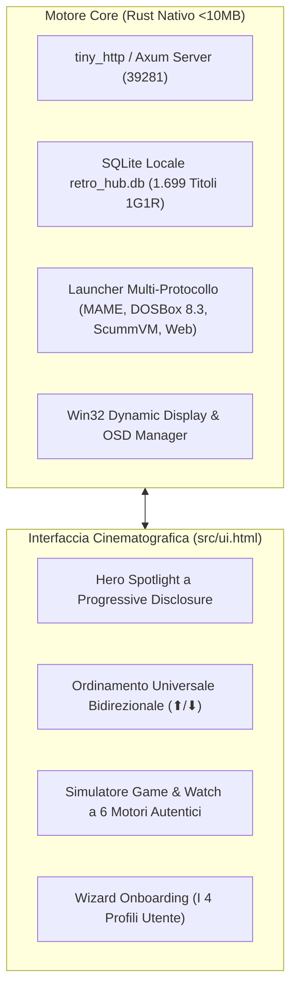

# 🧭 RetroHub — Punto della Situazione & Analisi Organica v0.47.0

**Data:** 20 Novembre 2026  
**Versione Software:** `v0.47.0` (Commit `2cff7e7`)  
**Branch:** `refactor-modular-rust`  
**Stato Repository:** Sincronizzato con GitHub (`boobaGreen/launcher_game`)  

---

## 1. Valutazione Strategica & Organicità delle Decisioni

RetroHub ha raggiunto un livello di maturità tecnica notevole. Le decisioni architetturali prese nelle ultime iterazioni si sono dimostrate **estremamente organiche, scalabili e coerenti** con la visione originale:

### I Punti di Forza Confermati:
1. **Paradigma 1G1R (Senza Duplicati)**: Escludere a monte cloni, dump regionali ridondanti (JAP/USA/EUR) e BIOS hardware mantiene il catalogo pulito, prestigioso e privo di spazzatura.
2. **Separazione Scheletro vs Muscolo (0-Byte su Disco)**: L'esperienza utente è istantanea come Steam o Spotify: metadati e copertine HD locali a 60 FPS offline; le ROM vengono scaricate on-demand solo al click `▶ GIOCA`.
3. **Immunità a Errori Windows**: L'introduzione di `to_short_path` (8.3 Short Path) per DOSBox e il passaggio a chiamate native Rust `Command::new` con escaping rigido prevengono crash con percorsi contenenti spazi o apostrofi (`ClaudioDall'Ara`).
4. **Multi-Monitor Dinamico**: Il launcher non si affida a identificativi statici (es. `\\.\DISPLAY2`), ma interroga Win32 ad ogni avvio e proietta notifiche OSD a tutto schermo per un feedback visivo immediato.

---

## 2. Il Numero Reale dei Giochi & Tassonomia Ufficiale

Il catalogo ufficiale `data/master_cloud_catalog.json` e il database locale `retro_hub.db` contengono esattamente **1.699 giochi autentici**, distribuiti su **12 Macro-Famiglie** e **35 Piattaforme**:

| Macro-Famiglia | Piattaforme Coinvolte | Titoli Totali | Note di Rilievo |
| :--- | :--- | :---: | :--- |
| **1. Arcade Coin-Op** | MAME (568), NEOGEO (120), NAOMI (27), ATOMISWAVE (8), HIKARU (4) | **727** | Eliminate le 5 schede tecniche non giocabili; integrato *Sega NASCAR Arcade*. |
| **2. Laserdisc & FMV** | HYPSEUS (Laserdisc Arcade) | **22** | 100% locandine originali WebP/PNG; supporto Daphne/Hypseus Singe. |
| **3. Pinball & Flipper** | PINBALL (Virtual Pinball) | **40** | 100% backglass ad alta risoluzione collegate. |
| **4. LCD & Game & Watch** | GAMEWATCH (Nintendo LCD) | **15** | 6 motori interattivi unici: *Ball*, *Fire*, *Parachute*, *Chef*, *Donkey Kong*, *Octopus*. |
| **5. Nintendo Universe** | SNES (86), NES (54), GBA (51), N64 (20), GAMECUBE (5) | **216** | Selezione 1G1R delle migliori cartucce e dischi Nintendo. |
| **6. Sega Universe** | MEGADRIVE (58), DREAMCAST (5) | **63** | Filtro unificato Mega Drive / Genesis per reperibilità globale. |
| **7. Sony PlayStation** | PSX (PlayStation 1) | **60** | Selezione dei classici 32-bit. |
| **8. Atari & Vintage** | ATARI2600 (15), ATARI7800 (4), INTELLIVISION (4), JAGUAR (4), LYNX (4), COLECO (3), VECTREX (3) | **37** | I pionieri delle generazioni pre-Crash 1983. |
| **9. SNK & NEC Engine** | Neo-Geo (incluso in Arcade/AES) + Espansioni PC Engine | *(Integ.)* | Già presente la libreria Neo-Geo AES/MVS a 120 titoli. |
| **10. Home Computer** | C64 (223), DOS (100), SCUMMVM (64), AMIGA (25) | **412** | Nuova macro-famiglia Commodore & Amiga unificata; percorsi 8.3 DOSBox. |
| **11. Nippon Micro PC** | MSX2 (8), X68000 (8), MSX (4), PC98 (4), FMTOWNS (3), PC88 (2) | **29** | Perle orientali giapponesi. |
| **12. PC Moderno & Indie** | RECOMP (45), INDIE (33) | **78** | Port 60 FPS nativi PC (*Zelda*, *Mario 64*) e capolavori freeware Indie. |
| **TOTALE GENERALE** | **35 Piattaforme Canoniche** | **1.699** | **Zero duplicati • Zero BIOS • 100% Verificato** |

---

## 3. I 4 Profili Utente del Wizard di Onboarding

Il wizard guidato al primo avvio garantisce la massima flessibilità di utilizzo per qualsiasi profilo di giocatore:

1. **Profilo 1 — Smart On-Demand (Default Consigliato)**:
   - *Target*: Utente che vuole giocare subito senza configurazioni.
   - *Comportamento*: Copertine HD locali (~400 MB per 10 console) per navigare a 60 FPS offline; ROM a **0 Byte preventivi** scaricate al click `▶ GIOCA` con gestione salva-spazio opzionale al termine.
2. **Profilo 2 — Collezione Locale Esistente (Power User)**:
   - *Target*: Utente con archivio ROM già presente su hard disk o SSD.
   - *Comportamento*: Scansione strutturata su una cartella radice (`emu/roms/<console>`); nessun file spostato o duplicato; i giochi locali appaiono in verde `▶ GIOCA`, quelli mancanti in ciano `☁️ SCARICA & GIOCA`.
3. **Profilo 3 — Low Storage / Handheld (Card Vettoriali)**:
   - *Target*: Dispositivi con memoria SSD minima (Steam Deck, ROG Ally, laptop 10 GB liberi).
   - *Comportamento*: **Zero immagini scaricate a monte (0 Byte)**; l'interfaccia mostra card tipografiche vettoriali con gradienti specifici per ogni console.
4. **Profilo 4 — Full Pack Offline**:
   - *Target*: Macchine arcade dedicate o cabinati offline.
   - *Comportamento*: Pre-download completo di copertine e romset per le piattaforme selezionate nelle Opzioni.

---

## 4. Nuove Meccaniche Introdotte in v0.47.0

- **Ordinamento Universale Bidirezionale**: Separato il selettore del criterio (Titolo, Anno, Dev, Genere, Rating, Giocate) dal tasto toggle di direzione `[ ⬆ / ⬇ ]` con etichette semantiche chiare (*A → Z* vs *Z → A*, *Più Recenti* vs *Più Storici*).
- **OSD Multi-Monitor**: Rilevamento in tempo reale degli schermi fisici, ordinamento spaziale da sinistra a destra e flash HUD di identificazione visuale a tutto schermo per 2,2 secondi.
- **Game & Watch a 6 Motori**: Minigiochi LCD completi di logica e animazioni fedeli agli originali Nintendo degli anni '80.
- **Intercettazione Falsi Positivi Download**: Arresto immediato della barra di avanzamento e notifica toast in caso di risposta `success: false` del server cloud.

---

## 5. Area Progetto & Strumenti Agenti

Per garantire continuità organica ed evitare dispersioni, l'ambiente di lavoro è ora corredato da:
- **`AGENTS.md`**: Regole permanenti di architettura, standard di codice e flussi di release.
- **`.agents/skills/retrohub-builder`**: Istruzioni per build release LTO, semver bump e commit.
- **`.agents/skills/retrohub-catalog`**: Istruzioni per validazione 1G1R e gestione metadati/boxart.
- **`.agents/skills/retrohub-launcher`**: Istruzioni per diagnostica OSD, percorsi 8.3 e parametri emulatori.
- **`scripts/normalize_platforms.py`**: Utility automatizzata per verificare e allineare le stringhe di piattaforma.
