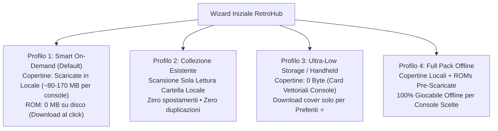

# 📊 Stima Completa Storage, Immagini & ROM per Piattaforma

**Progetto:** RetroHub — Client Retrogaming Nativo (Rust)  
**Versione:** 1.0 (Ricalcolo Matematico & Dimensionamento Asset)  
**Data:** 19 Novembre 2026  
**Target:** `launcher_game/docs/STIME_STORAGE_PIATTAFORME_IMMAGINI.md`  

---

## 🎯 1. Obiettivo del Documento

Questo documento formalizza in maniera quantitativa e scientifica il **peso in Megabyte e Gigabyte** di ciascun elemento che compone l'ecosistema RetroHub:
1. **Metadati** (Record SQLite, indici di ricerca, tag, sviluppatori, anni, generi).
2. **Boxart Frontali (Aspect Ratio 2:3)** (Copertine della griglia principale).
3. **Immagini Secondarie** (Screenshot in-game *Snaps*, schermate iniziali *Title Screens*, marquee arcade).
4. **Hero Artwork Panoramiche (Widescreen 1920×620)** (Banner cinemagrafici per la vetrina in evidenza).
5. **File ROM / Giochi** (Archivi compressi `.zip`, `.chd`, `.rvz`, eseguibili nativi PC).

---

## 📐 2. Unità di Misura & Standard di Compressione

Tutte le stime si basano sui formati industriali adottati da RetroHub:
* **Metadati Singolo Gioco:** **~1 KB** indicizzato in SQLite (`retro_hub.db`).
* **Boxart Frontale Standard (2:3, 400×560px):** Formato PNG/WebP ottimizzato: **~90 KB – 130 KB** (media ponderata: **110 KB**).
* **Screenshot In-Game / Title Screen (4:3 o nativo):** Formato WebP compresso: **~80 KB – 120 KB** (media: **95 KB**).
* **Hero Widescreen Banner (1920×620px):** Asset ad altissima fedeltà Steam/RetroHub con gradiente: **~250 KB – 380 KB** (media: **300 KB**).

---

## 📋 3. Matrice Dettagliata per Piattaforma (Top Classici vs Full Set)

Di seguito la suddivisione accurata per ciascuno dei sistemi storici supportati nelle 12 Macro-Famiglie:

| Piattaforma | Codice | Titoli Top Classici | Titoli Full Set | Peso Boxart Top (MB) | Peso Boxart Full (MB) | Peso Snaps/Titles Full (MB) | Peso Medio 1 ROM | Peso Totale ROM Full Set |
| :--- | :--- | :---: | :---: | :---: | :---: | :---: | :---: | :---: |
| **Super Nintendo** | `SNES` | 50 | 780 | 5.5 MB | **85 MB** | 74 MB | ~1.5 MB (`.sfc.zip`) | **~1.1 GB** |
| **Nintendo NES** | `NES` | 50 | 710 | 5.5 MB | **78 MB** | 67 MB | ~200 KB (`.nes.zip`) | **~140 MB** |
| **Nintendo 64** | `N64` | 40 | 388 | 4.4 MB | **42 MB** | 36 MB | ~12 MB (`.z64.zip`) | **~4.6 GB** |
| **Game Boy Advance** | `GBA` | 50 | 1.050 | 5.5 MB | **115 MB** | 99 MB | ~6 MB (`.gba.zip`) | **~6.3 GB** |
| **Game Boy / Color** | `GB` | 40 | 1.000 | 4.4 MB | **110 MB** | 95 MB | ~400 KB (`.gb.zip`) | **~400 MB** |
| **Nintendo GameCube** | `GAMECUBE` | 30 | 650 | 3.3 MB | **71 MB** | 61 MB | ~1.2 GB (`.rvz`) | **~780 GB** |
| **Sega Mega Drive** | `MEGADRIVE`| 50 | 880 | 5.5 MB | **96 MB** | 83 MB | ~1.2 MB (`.md.zip`) | **~1.0 GB** |
| **Sega Master System** | `MASTERSYSTEM`| 30 | 340 | 3.3 MB | **37 MB** | 32 MB | ~250 KB (`.sms.zip`)| **~85 MB** |
| **Sega Saturn** | `SATURN` | 30 | 600 | 3.3 MB | **66 MB** | 57 MB | ~450 MB (`.chd`) | **~270 GB** |
| **Sega Dreamcast** | `DREAMCAST` | 30 | 620 | 3.3 MB | **68 MB** | 58 MB | ~600 MB (`.chd`) | **~370 GB** |
| **Sony PlayStation 1** | `PSX` | 50 | 1.450 | 5.5 MB | **159 MB** | 137 MB | ~400 MB (`.chd`) | **~580 GB** |
| **Sony PlayStation 2** | `PS2` | 40 | 2.000 | 4.4 MB | **220 MB** | 190 MB | ~1.8 GB (`.chd/iso`)| **~3.6 TB** |
| **Sony PSP** | `PSP` | 30 | 1.100 | 3.3 MB | **121 MB** | 104 MB | ~700 MB (`.cso/chd`)| **~770 GB** |
| **Arcade MAME (1G1R Parent - Default)** | `ARCADE` | 100 | **950** | 11.0 MB | **105 MB** | 90 MB | ~29 MB (`.zip`) | **~28 GB** |
| **Arcade MAME (Full Set Cloni/Regionali)** | `ARCADE_ALL` | 100 | 3.200 | 11.0 MB | **352 MB** | 304 MB | ~15 MB (`.zip`) | **~48 GB** |
| **SNK Neo Geo** | `NEOGEO` | 40 | 150 | 4.4 MB | **16 MB** | 14 MB | ~25 MB (`.zip`) | **~3.7 GB** |
| **NEC PC Engine** | `PCENGINE` | 30 | 420 | 3.3 MB | **46 MB** | 39 MB | ~1.5 MB (`.pce.zip`)| **~630 MB** |
| **Commodore 64** | `C64` | 50 | 3.000 | 5.5 MB | **330 MB** | 285 MB | ~60 KB (`.d64/.t64`)| **~180 MB** |
| **Commodore Amiga** | `AMIGA` | 40 | 1.800 | 4.4 MB | **198 MB** | 171 MB | ~1.5 MB (`.adf/.hdf`)| **~2.7 GB** |
| **MS-DOS PC Classics**| `DOS` | 40 | 1.200 | 4.4 MB | **132 MB** | 114 MB | ~15 MB (`.zip`) | **~18 GB** |
| **ScummVM Avventure** | `SCUMMVM` | 30 | 180 | 3.3 MB | **19 MB** | 17 MB | ~80 MB (`.svm.zip`) | **~14 GB** |
| **Atari 2600 & Vintage**| `ATARI2600`| 30 | 500 | 3.3 MB | **55 MB** | 47 MB | ~10 KB (`.a26.zip`) | **~5 MB** |
| **Laserdisc FMV** | `LASERDISC` | 10 | 45 | 1.1 MB | **5 MB** | 4 MB | ~1.5 GB (Video HD) | **~67 GB** |
| **Pinball Elettronico** | `PINBALL` | 15 | 120 | 1.6 MB | **13 MB** | 11 MB | ~35 MB (`.vpx`) | **~4.2 GB** |
| **Nintendo Game&Watch** | `GAMEWATCH` | 15 | 60 | 1.6 MB | **6 MB** | 5 MB | ~50 KB (`.mgw`) | **~3 MB** |
| **PC Recomp 60FPS** | `RECOMP` | 25 | 45 | 2.7 MB | **5 MB** | 4 MB | ~40 MB (Eseguibili) | **~1.8 GB** |
| **PC Indie Freeware** | `INDIE` | 35 | 60 | 3.8 MB | **6 MB** | 5 MB | ~30 MB (Cartelle PC)| **~1.8 GB** |

---

## ⚡ 3.1 La Regola Aurea di RetroHub: Piattaforma Sbloccata = Copertine Locali HD + ROM 100% On-Demand

Questa specifica architetturale definisce il comportamento univoco e definitivo del software:

1. **Al Momento dello Sblocco della Piattaforma (Console Attivata):**
   * RetroHub scarica e memorizza in locale nella cartella `covers/<piattaforma>/` il **pacchetto completo delle copertine HD** (in formato WebP/PNG ultra-compresso da ~90-110 KB a titolo).
   * **Prestazioni Garantite:** Navigazione della griglia a **60 FPS nativi a 0ms di latenza**, zero dipendenza dalla rete, zero buchi o "flickering" durante lo scroll veloce, **consultazione al 100% fruibile anche offline** senza connessione internet.
   * **Impatto Reale su Disco:** Pochi Megabyte per console!
     * Super Nintendo (SNES): **~85 MB** (780 titoli)
     * Nintendo NES: **~78 MB** (710 titoli)
     * Sega Mega Drive: **~96 MB** (880 titoli)
     * Game Boy Advance: **~115 MB** (1.050 titoli)
     * Sony PlayStation (PS1): **~159 MB** (1.450 titoli)
     * Arcade MAME (1G1R Parent): **~105 MB** (950 titoli unici)
     * **Top 5 Console Regine:** **~450 MB complessivi** di sole copertine per oltre 4.500 capolavori storici!

2. **File ROM (I Giochi Effettivi):**
   * **Rigorosamente 0 Byte preventivi su disco**. Nessun romset pesante scaricato a vuoto.
   * Il trasferimento della singola ROM avviene **100% On-Demand al click `▶ GIOCA`** (download in background in 1-3 secondi per cartucce, streaming veloce per CD).
   * **Dialog Salva-Spazio Post-Partita:** Alla chiusura dell'emulatore l'utente sceglie se conservare la ROM sul disco o rimuoverla per ripristinare all'istante lo storage a 0 byte.

3. **Strategia MAME (Arcade Pulito 1G1R vs Full Cloni):**
   * **Default Consigliato (1G1R Parent-Only):** Catalogo di **~950 titoli storici originali (Parent ROM)**, escludendo cloni, bootleg, mahjong, quiz giapponesi e slot machine. Copertine: **105 MB**, ROM totali on-demand: **~28 GB**.
   * **Visualizzazione Completa Cloni/Regionali:** Consultabile e attivabile tramite apposito filtro toggle nel pannello di ricerca o dalla scheda dettagli del gioco.

---

## 🧮 4. Analisi Comparativa dei 4 Profili Utente del Wizard

### 🟢 Profilo 1: Smart On-Demand Standard (Default Consigliato di RetroHub)
* **Ideale per:** Chi desidera un'esperienza fluida da console moderna (stile Steam/Netflix), senza sprecare gigabyte di memoria per ROM che non giocherà mai.
* **Funzionamento:**
  * L'utente sceglie le piattaforme da sbloccare (es. Top 5 o Top 10 + Indie Freeware).
  * **Copertine & Metadati:** Vengono scaricate e memorizzate in locale le copertine HD delle piattaforme selezionate (~350–450 MB per 5 console), garantendo navigazione a 60 FPS nativi e consultazione offline.
  * **File ROM:** **0 MB sul disco** all'avvio. La singola ROM viene scaricata all'istante solo quando l'utente preme `▶ GIOCA`.
  * **Post-Partita:** Possibilità di ripulire automaticamente la cartella download a fine sessione o conservare i titoli giocati.
* **Impatto su disco:** Solo il pacchetto copertine delle console sbloccate + database SQLite (~350 MB totali per 5 console storiche).

### 🟡 Profilo 2: Collezione Esistente (Zero Spostamenti)
* **Ideale per:** Chi possiede già il proprio archivio di ROM o giochi PC Indie sul proprio computer o hard disk esterno.
* **Funzionamento:**
  * Scansione in sola lettura della cartella radice indicata dall'utente (es. `roms/snes/`, `roms/mame/`, `roms/indie/`).
  * **Garanzia Assoluta:** RetroHub NON copia, NON sposta, NON rinomina e NON tocca mai i file originali.
  * Sblocca automaticamente le piattaforme corrispondenti e associa le copertine locali dedicate.
* **Impatto su disco:** 0 byte aggiuntivi per le ROM; sfrutta interamente lo storage esistente.

### 🔵 Profilo 3: Ultra-Low Storage / Handheld (Placeholder Vettoriali)
* **Ideale per:** Dispositivi con memoria SSD critica (ROG Ally, Steam Deck 64GB, laptop con pochi GB liberi).
* **Funzionamento:**
  * **0 Byte per le immagini a monte:** Nessun pacchetto copertine scaricato all'avvio.
  * Tutte le card a video utilizzano eleganti **Card Tipografiche Vettoriali Dinamiche** stilizzate nei colori sociali originali della console con font retro e filigrane geometriche.
  * La copertina reale HD viene scaricata e memorizzata in locale **solo ed esclusivamente** quando il gioco viene avviato o contrassegnato con la stella ⭐ nei Preferiti (limite cache LRU 50-100 MB).
* **Impatto su disco:** **0 MB per le immagini**; solo il database SQLite nativo (~35 MB).

### 🟣 Profilo 4: Full Pack Offline (Console Selezionate o Archivio Totale)
* **Ideale per:** Chi deve viaggiare senza alcuna connessione internet o possiede dischi capienti (SSD 2TB-4TB+) e vuole l'intero romset sempre disponibile offline.
* **Funzionamento:**
  * L'utente seleziona le specifiche console da archiviare offline (es. SNES ~1.1 GB, Mega Drive ~1.0 GB, MAME 1G1R ~28 GB).
  * RetroHub scarica sia l'intero pacchetto copertine HD sia il set completo di ROM per le sole piattaforme prescelte.
  * Le ROM rimangono sempre archiviate e pronte sul disco senza necessità di download al click.
* **Impatto su disco:** Da pochi Gigabyte per le console 8/16-bit fino a centinaia di Gigabyte per i sistemi ottici.

---

## 🛠️ 5. Policy di Gestione Cache Locale (`cache/covers/`)

Per garantire che la memoria del computer rimanga sempre pulita e controllata:
1. **Algoritmo LRU (Least Recently Used):** Quando la cartella temporanea delle immagini supera il tetto configurato (es. **150 MB**), le copertine dei giochi non visualizzati da più tempo vengono rimosse automaticamente.
2. **Protezione dei Preferiti ⭐:** Le immagini dei titoli contrassegnati come preferiti non vengono mai eliminate dalla cache locale.
3. **Pulsante Svuota Cache:** Presente nel menu impostazioni per consentire all'utente di reimpostare a 0 byte la cache locale con un singolo click.
