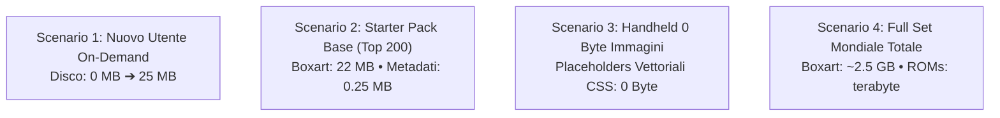

# 📊 Stima Completa Storage, Immagini & ROM per Piattaforma

**Progetto:** RetroHub — Client Retrogaming Nativo (Rust)  
**Versione:** 1.0 (Ricalcolo Matematico & Dimensionamento Asset)  
**Data:** 19 Novembre 2026  
**Target:** `launcher_game/docs/STIME_STORAGE_PIATTAFORME_IMMAGINI.md`  

---

## 🎯 1. Obiettivo del Documento

Questo documento formalizza in maniera quantitativa e scientifica il **peso in Megabyte e Gigabyte** di ciascun elemento che compone l'ecosistema RetroHub:
1. **Metadati** (Record SQLite, indici di ricerca, tag, sviluppatori, anni, generi).
2. **Boxart Frontali (Aspect Ratio 2:3)** (Copertine della griglia principale).
3. **Immagini Secondarie** (Screenshot in-game *Snaps*, schermate iniziali *Title Screens*, marquee arcade).
4. **Hero Artwork Panoramiche (Widescreen 1920×620)** (Banner cinemagrafici per la vetrina in evidenza).
5. **File ROM / Giochi** (Archivi compressi `.zip`, `.chd`, `.rvz`, eseguibili nativi PC).

---

## 📐 2. Unità di Misura & Standard di Compressione

Tutte le stime si basano sui formati industriali adottati da RetroHub:
* **Metadati Singolo Gioco:** **~1 KB** indicizzato in SQLite (`retro_hub.db`).
* **Boxart Frontale Standard (2:3, 400×560px):** Formato PNG/WebP ottimizzato: **~90 KB – 130 KB** (media ponderata: **110 KB**).
* **Screenshot In-Game / Title Screen (4:3 o nativo):** Formato WebP compresso: **~80 KB – 120 KB** (media: **95 KB**).
* **Hero Widescreen Banner (1920×620px):** Asset ad altissima fedeltà Steam/RetroHub con gradiente: **~250 KB – 380 KB** (media: **300 KB**).

---

## 📋 3. Matrice Dettagliata per Piattaforma (Top Classici vs Full Set)

Di seguito la suddivisione accurata per ciascuno dei sistemi storici supportati nelle 12 Macro-Famiglie:

| Piattaforma | Codice | Titoli Top Classici | Titoli Full Set | Peso Boxart Top (MB) | Peso Boxart Full (MB) | Peso Snaps/Titles Full (MB) | Peso Medio 1 ROM | Peso Totale ROM Full Set |
| :--- | :--- | :---: | :---: | :---: | :---: | :---: | :---: | :---: |
| **Super Nintendo** | `SNES` | 50 | 780 | 5.5 MB | **85 MB** | 74 MB | ~1.5 MB (`.sfc.zip`) | **~1.1 GB** |
| **Nintendo NES** | `NES` | 50 | 710 | 5.5 MB | **78 MB** | 67 MB | ~200 KB (`.nes.zip`) | **~140 MB** |
| **Nintendo 64** | `N64` | 40 | 388 | 4.4 MB | **42 MB** | 36 MB | ~12 MB (`.z64.zip`) | **~4.6 GB** |
| **Game Boy Advance** | `GBA` | 50 | 1.050 | 5.5 MB | **115 MB** | 99 MB | ~6 MB (`.gba.zip`) | **~6.3 GB** |
| **Game Boy / Color** | `GB` | 40 | 1.000 | 4.4 MB | **110 MB** | 95 MB | ~400 KB (`.gb.zip`) | **~400 MB** |
| **Nintendo GameCube** | `GAMECUBE` | 30 | 650 | 3.3 MB | **71 MB** | 61 MB | ~1.2 GB (`.rvz`) | **~780 GB** |
| **Sega Mega Drive** | `MEGADRIVE`| 50 | 880 | 5.5 MB | **96 MB** | 83 MB | ~1.2 MB (`.md.zip`) | **~1.0 GB** |
| **Sega Master System** | `MASTERSYSTEM`| 30 | 340 | 3.3 MB | **37 MB** | 32 MB | ~250 KB (`.sms.zip`)| **~85 MB** |
| **Sega Saturn** | `SATURN` | 30 | 600 | 3.3 MB | **66 MB** | 57 MB | ~450 MB (`.chd`) | **~270 GB** |
| **Sega Dreamcast** | `DREAMCAST` | 30 | 620 | 3.3 MB | **68 MB** | 58 MB | ~600 MB (`.chd`) | **~370 GB** |
| **Sony PlayStation 1** | `PSX` | 50 | 1.450 | 5.5 MB | **159 MB** | 137 MB | ~400 MB (`.chd`) | **~580 GB** |
| **Sony PlayStation 2** | `PS2` | 40 | 2.000 | 4.4 MB | **220 MB** | 190 MB | ~1.8 GB (`.chd/iso`)| **~3.6 TB** |
| **Sony PSP** | `PSP` | 30 | 1.100 | 3.3 MB | **121 MB** | 104 MB | ~700 MB (`.cso/chd`)| **~770 GB** |
| **Arcade (MAME)** | `ARCADE` | 100 | 3.200 | 11.0 MB | **352 MB** | 304 MB | ~15 MB (`.zip`) | **~48 GB** |
| **SNK Neo Geo** | `NEOGEO` | 40 | 150 | 4.4 MB | **16 MB** | 14 MB | ~25 MB (`.zip`) | **~3.7 GB** |
| **NEC PC Engine** | `PCENGINE` | 30 | 420 | 3.3 MB | **46 MB** | 39 MB | ~1.5 MB (`.pce.zip`)| **~630 MB** |
| **Commodore 64** | `C64` | 50 | 3.000 | 5.5 MB | **330 MB** | 285 MB | ~60 KB (`.d64/.t64`)| **~180 MB** |
| **Commodore Amiga** | `AMIGA` | 40 | 1.800 | 4.4 MB | **198 MB** | 171 MB | ~1.5 MB (`.adf/.hdf`)| **~2.7 GB** |
| **MS-DOS PC Classics**| `DOS` | 40 | 1.200 | 4.4 MB | **132 MB** | 114 MB | ~15 MB (`.zip`) | **~18 GB** |
| **ScummVM Avventure** | `SCUMMVM` | 30 | 180 | 3.3 MB | **19 MB** | 17 MB | ~80 MB (`.svm.zip`) | **~14 GB** |
| **Atari 2600 & Vintage**| `ATARI2600`| 30 | 500 | 3.3 MB | **55 MB** | 47 MB | ~10 KB (`.a26.zip`) | **~5 MB** |
| **Laserdisc FMV** | `LASERDISC` | 10 | 45 | 1.1 MB | **5 MB** | 4 MB | ~1.5 GB (Video HD) | **~67 GB** |
| **Pinball Elettronico** | `PINBALL` | 15 | 120 | 1.6 MB | **13 MB** | 11 MB | ~35 MB (`.vpx`) | **~4.2 GB** |
| **Nintendo Game&Watch** | `GAMEWATCH` | 15 | 60 | 1.6 MB | **6 MB** | 5 MB | ~50 KB (`.mgw`) | **~3 MB** |
| **PC Recomp 60FPS** | `RECOMP` | 25 | 45 | 2.7 MB | **5 MB** | 4 MB | ~40 MB (Eseguibili) | **~1.8 GB** |
| **PC Indie Freeware** | `INDIE` | 35 | 60 | 3.8 MB | **6 MB** | 5 MB | ~30 MB (Cartelle PC)| **~1.8 GB** |

---

## 🧮 4. Analisi Comparativa dei 4 Scenari d'Uso (Footprint Totale)

### 🟢 Scenario 1: Modalità Vergine On-Demand (Default di RetroHub)
* **Spazio occupato all'installazione:** **0 MB** (zero file scaricati preventivamente).
* **Funzionamento:** Tutte le copertine vengono caricate in streaming lazy tramite cache del browser. La ROM viene scaricata istantaneamente solo nel momento in cui l'utente preme `▶ GIOCA`.
* **Consumo disco dopo 50 partite:** **~12 MB** di immagini in cache + i soli giochi salvati nei Preferiti.

### 🟡 Scenario 2: Il "Pacchetto Base" (Starter Pack Top 200 Giochi Curati)
Ideato per la configurazione guidata (Setup Wizard) per chi vuole un archivio curato dei migliori capolavori storici (MAME, NES, SNES, Mega Drive, PS1, N64, C64, DOS, ScummVM, Amiga, Indie):
* **Numero Titoli:** **200 Giochi**.
* **Metadati SQLite:** **0.25 MB** (istantaneo).
* **Boxart Frontali 2:3:** 200 × 110 KB = **~22 MB**.
* **Hero Panoramiche (Top 10 in rotazione):** **~3 MB**.
* **Screenshot e Title Screens:** Caricati solo on-demand nel modale dettaglio (**~0 MB** preventivi).
* **Impatto Totale Starter Pack:** **Meno di 26 MB totali**!

### 🔵 Scenario 3: Profilo Handheld / Low Storage (Placeholder Vettoriali)
Pensato per dispositivi con storage critico (ROG Ally, Steam Deck 64GB, laptop con disco quasi pieno):
* **Copertine scaricate a monte:** **0 Byte**.
* **Interfaccia:** Utilizza card tipografiche dinamiche basate sui colori societari della console, con font retro e filigrane vettoriali integrate.
* **Download copertina reale:** Solo quando il gioco viene scaricato localmente o contrassegnato con la stella ⭐ nei Preferiti.

### 🟣 Scenario 4: Full Set Mondiale Offline (Archiviazione Massiva)
Se un utente volesse scaricare preventivamente tutte le copertine dell'intera storia dei videogiochi:
* **Copertine Boxart (Tutte le console):** **~2.4 GB**.
* **Screenshot In-game (Tutti i giochi):** **~2.1 GB**.
* **Title Screens storiche:** **~1.8 GB**.
* **Totale Asset Grafici Completi:** **~6.3 GB**.
* **Conclusioni:** Questo dato dimostra l'eccellenza della scelta di RetroHub: **utilizzare lo streaming lazy on-demand evita all'utente di dover attendere il download di oltre 6 GB di immagini**, garantendo un'esperienza immediata, moderna e reattiva.

---

## 🛠️ 5. Policy di Gestione Cache Locale (`cache/covers/`)

Per garantire che la memoria del computer rimanga sempre pulita e controllata:
1. **Algoritmo LRU (Least Recently Used):** Quando la cartella temporanea delle immagini supera il tetto configurato (es. **150 MB**), le copertine dei giochi non visualizzati da più tempo vengono rimosse automaticamente.
2. **Protezione dei Preferiti ⭐:** Le immagini dei titoli contrassegnati come preferiti non vengono mai eliminate dalla cache locale.
3. **Pulsante Svuota Cache:** Presente nel menu impostazioni per consentire all'utente di reimpostare a 0 byte la cache locale con un singolo click.
