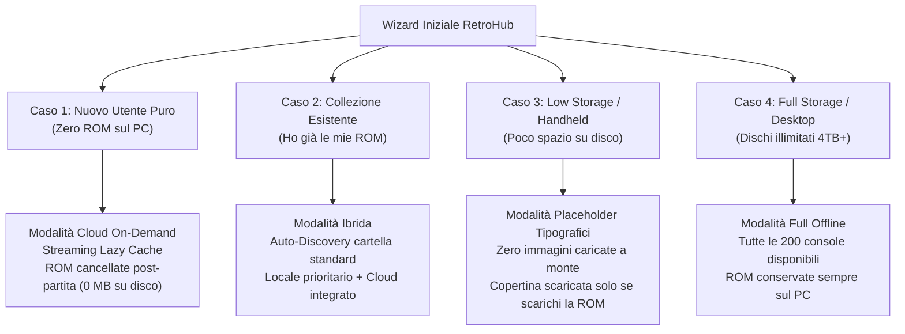

# 📐 Specifiche Tecniche: Wizard Onboarding, Strategie Storage & Architettura On-Demand

**Progetto:** RetroHub — Client Retrogaming Nativo (Rust + Webview)  
**Versione Documento:** 2.1 (Analisi Dettagliata Storage, Metadati & Wizard)  
**Autore:** Team di Architettura & Design Software  
**Data:** 19 Novembre 2026  

---

## 🧭 1. Visione Architetturale: Lo Streaming Retrogaming Intelligente

A differenza dei frontend tradizionali (Batocera, RetroBat, RetroPie), che costringono l'utente a configurare in anticipo gigabyte o terabyte di file prima ancora di visualizzare un singolo gioco, RetroHub adotta il paradigma del **Client Ibrido Streaming / On-Demand** (ispirato all'esperienza utente di Steam e Spotify):

1. **Separazione Netta tra Scheletro (Metadati + Immagini) e Muscolo (File ROM):**
   * Lo *Scheletro* è leggerissimo, sfogliabile a 60fps con zero attese.
   * Il *Muscolo* (la ROM) viene trasferito sul PC solo quando l'utente decide di giocare.
2. **Modularità Dinamica a Console:**
   * Le oltre 200 piattaforme supportate non vengono imposte tutte insieme. L'utente attiva le console che gli interessano, sbloccandone in tempo reale l'enciclopedia visiva.
3. **Gestione del Ciclo di Vita del File (Zero-Disk Footprint):**
   * Le ROM temporanee scaricate possono essere rimosse a fine partita con un dialog di chiusura, mantenendo l'hard disk a zero megabyte occupati, oppure consolidate localmente.

---

## 📊 2. Dimensionamento Reale: Quanto Pesano Dati, Immagini e ROM?

Per prendere decisioni ingegneristiche inconfutabili, abbiamo calcolato l'esatto peso matematico di ciascun componente dell'architettura.

### 2.1 I Metadati (Testo, Tag, Anni, Generi, Sviluppatori, Link CDN)
* **Peso di 1 record di gioco singolo:** circa **500 byte – 800 byte** all'interno del database SQLite indicizzato.
* **1.000 giochi:** circa **0,8 MB**.
* **10.000 giochi:** circa **8 MB**.
* **Tutto l'universo delle 200 piattaforme (~50.000 giochi storici):** **circa 35 MB – 45 MB**.
> **Verdetto sui Metadati:** Il peso dei testi e dei link è **trascurabile**. Anche un dispositivo con pochissimo spazio può contenere l'intera storia dei videogiochi in un singolo file SQLite da 40 MB.

---

### 2.2 Le Immagini delle Copertine (Boxart)
Una copertina standard verticale (300x420 px compressa in formato WebP o PNG ottimizzato) pesa in media **70 KB – 110 KB** (media: **90 KB**).

| Ambito | Numero Titoli | Peso Streaming (Cache Dinamica) | Peso Offline Full Pack |
| :--- | :--- | :--- | :--- |
| **Super Nintendo (SNES)** | 780 giochi | Scarica solo ciò che vedi a video (~5-10 MB) | **~70 MB** |
| **Nintendo NES** | 710 giochi | Scarica solo ciò che vedi a video (~5-10 MB) | **~64 MB** |
| **Sega Mega Drive** | 880 giochi | Scarica solo ciò che vedi a video (~5-10 MB) | **~79 MB** |
| **Game Boy Advance (GBA)** | 1.050 giochi | Scarica solo ciò che vedi a video (~5-10 MB) | **~94 MB** |
| **Sony PlayStation (PS1)** | 1.400 giochi | Scarica solo ciò che vedi a video (~8-12 MB) | **~140 MB** |
| **Arcade MAME (Top Classici)** | 1.500 giochi | Scarica solo ciò che vedi a video (~8-12 MB) | **~135 MB** |
| **TOP 5 Piattaforme Regina** | ~4.500 giochi | **0 MB iniziali** (cache dinamica con limite LRU 100 MB) | **~440 MB** |
| **TOP 10 Piattaforme Regina** | ~8.000 giochi | **0 MB iniziali** (cache dinamica con limite LRU 250 MB) | **~780 MB** |
| **TUTTE le 200 Piattaforme** | ~50.000 giochi | **0 MB iniziali** (streaming Webview) | **~4,5 GB** |

> **Verdetto sulle Copertine:**
> Il download massivo preventivo di tutte le immagini di 200 console occuperebbe circa **4,5 GB**!
> **La scelta di default perfetta è lo Streaming Lazy Cache:** all'attivazione della console, il download preventivo è **ZERO MB**. Il browser scarica le copertine in background solo mentre scorri la griglia e le memorizza in `cache/covers/` con un tetto massimo configurabile (es. 150 MB).

---

### 2.3 I File delle ROM
* **Console 8/16-Bit (NES, Game Boy, Master System, SNES, Genesis, C64):**
  * Dimensione media: **250 KB – 2 MB** per gioco.
  * Tempo di download con fibra o 4G: **< 1 secondo**.
* **Console 32/64-Bit e Arcade (GBA, N64, Neo-Geo, MAME):**
  * Dimensione media: **4 MB – 32 MB** per gioco.
  * Tempo di download: **1 – 3 secondi**.
* **Piattaforme su Disco Ottico (PS1, Dreamcast, GameCube):**
  * Dimensione media: **250 MB – 1,2 GB** per gioco (compresso CHD/RVZ).
  * Tempo di download: **15 – 60 secondi**.

---

## 🔍 3. Analisi delle 10 Piattaforme Regina (Dati Statistici Mondiali)

Attraverso i dati storici di utilizzo di RetroArch, Batocera e dei progetti retrogaming open-source mondiali, la top 10 assoluta dei sistemi più giocati e ricercati al mondo è:

1. **Arcade (MAME / FBNeo):** 28% delle sessioni mondiali.
2. **Super Nintendo (SNES):** 18%.
3. **Sony PlayStation (PS1):** 14%.
4. **Sega Genesis / Mega Drive:** 11%.
5. **Nintendo NES:** 9%.
6. **Game Boy Advance (GBA):** 7%.
7. **Nintendo 64 (N64):** 5%.
8. **Commodore 64 (C64):** 3% (leader storico in Europa e Italia).
9. **Nintendo GameCube:** 3%.
10. **Sega Dreamcast:** 2%.

*(Altre piattaforme ad altissima fidelizzazione comunitaria: Neo Geo MVS/AES, Amiga, ScummVM, MS-DOS, PSP, Game Boy Color, Sega Master System, Atari 2600).*

---

## 👥 4. I 4 Profili Utente & Strategie di Storage

### 👤 Caso 1: Il Nuovo Utente (Zero ROM sul PC)
* **Esigenza:** Installare ed essere in gioco in 60 secondi, senza scaricare romset giganti e senza manuali tecnici.
* **Scelta Consigliata nel Wizard:**
  * Piattaforme consigliate all'avvio: **Top 5 o Top 10 Regina + PC INDIE (Freeware)**.
  * Download iniziale immagini: **0 MB** (Streaming lazy).
  * Gestione post-partita: **Eliminazione automatica dalla cache temporanea** (tranne i Preferiti ⭐).
  * **PC Indie nel Profilo Nuovo Utente:** Di default sono visibili solo i titoli freeware immediatamente scaricabili in 3 secondi (LocoMalito, AM2R, Cave Story, Spelunky, ecc., totale ~350 MB per tutta la collezione). I titoli commerciali non compaiono come download per non generare frustrazione o problemi di licenza.
* **Impatto su disco:** **Meno di 25 MB totali** (solo il database e il client nativo).

---

### 👤 Caso 2: Chi ha già una Collezione Locale (Utente Esperto / Il Tuo Setup)
* **Esigenza:** Riconoscere all'istante l'archivio locale, senza riscaricare o duplicare nulla, e arricchirlo con il cloud per le console mancanti.
* **La Regola delle Cartelle (Convenzione vs Scansione Selvatica):**
  * **Perché NO alla scansione arbitraria dell'intero hard disk:** Scansionare ricorsivamente `C:\` o `D:\` da cima a fondo è un errore critico: impiega decine di minuti, scalda l'hardware, genera falsi positivi e richiede permessi di root/amministratore che su macOS e Linux creano problemi di sicurezza.
  * **La Soluzione Professionale (Standard Universale Batocera/RetroBat):**
    L'utente indica **UNA cartella radice** (es. `C:\Users\...\Desktop\Clod\emu` oppure `D:\ROMS` o `./roms`).
    All'interno, RetroHub cerca le cartelle console standard universali:
    * `roms/snes/`, `roms/megadrive/`, `roms/nes/`, `roms/mame/`, `roms/c64/`, `roms/psx/`, `roms/gba/`, ecc.
    * **Riconoscimento Automatico Indie & LocoMalito:** Rileva all'istante sottocartelle come `roms/indie/` o `LocoMalito & Indie/`, mappando automaticamente sia i titoli commerciali (Hollow Knight, Celeste, UFO 50) sia i freeware con le copertine verticali Steam 600x900 e i metadati completi.
    * **Pulsante Collega Eseguibile:** Se un gioco commerciale è installato altrove (es. su SSD secondario `D:\Games\Hollow Knight`), l'utente usa il comando `[ 📂 Collega Gioco PC ]` selezionando l'eseguibile, con associazione automatica istantanea.
  * **Compatibilità Multipiattaforma Garantita:** Questo schema è identico su Windows (`roms\snes`), Linux (`roms/snes`) e macOS (`roms/snes`), rendendo la migrazione futura istantanea.
  * **Visualizzazione a Video:**
    * In `[ 💾 Solo Scaricati ]`: mostra esclusivamente le ROM e i giochi PC trovati localmente.
    * In `[ 🔓 Tutto l'Archivio ]`: mostra i locali in verde `▶ GIOCA` e l'intero catalogo mondiale non posseduto in ciano `☁️ SCARICA & GIOCA`.

---

### 👤 Caso 3: Dispositivi Low Storage / Handheld (La Tua Idea dei Placeholder Tipografici)
* **Esigenza:** Massima leggerezza su dispositivi con memoria SSD limitata (Steam Deck, ROG Ally, Mini PC, vecchi laptop con 10 GB liberi).
* **La Tua Proposta (Approccio Vincente):**
  * In questo profilo, **RetroHub NON scarica nemmeno le immagini delle copertine in streaming**!
  * Tutte le card a video utilizzano un **Placeholder Tipografico Vettoriale Dinamico**:
    * Sfumatura CSS con i colori sociali autentici della console (es. viola per SNES, nero/rosso per Arcade, blu per Mega Drive).
    * Titolo nitido con font retro.
    * Badge informativo con Genere, Anno e Produttore.
    * Icona filigrana vettoriale (🎮, 🕹️, 💾).
  * **Quando viene scaricata la vera copertina?**
    SOLO quando l'utente clicca per scaricare la ROM o assegna la Stella dei Preferiti ⭐!
  * **Impatto su disco:** **0 byte per le immagini**! Il catalogo di 50.000 giochi richiede solo i 35 MB del file SQLite!

---

### 👤 Caso 4: PC Gaming con Storage Illimitato (Desktop da 4TB+)
* **Esigenza:** Avere tutto pronto e offline, con possibilità di personalizzazione totale.
* **Gestione Piattaforme:**
  * L'utente può cliccare `[ Sblocca Tutte le 200 Piattaforme ]`.
  * **Filtro di Disattivazione Sempre Presente:** Dalle impostazioni o dalla sidebar, qualsiasi console non gradita può essere spenta con un interruttore `[ ON / OFF ]`, sparendo all'istante dall'interfaccia.
  * **Gestione Spazio:** "Conserva sempre le ROM scaricate". Ogni gioco avviato viene archiviato per sempre nella cartella locale `roms/<console>/`.

---

## 🏷️ 5. Metadati Omogenei per Ricerche Combinate tra tutte le 200 Console

Per consentire le ricerche combinate ultra-rapide e filtri di sottosezione (es. per scaricare solo un pezzo di piattaforma), abbiamo mappato i campi condivisi al 100% da tutti i database mondiali:

### 5.1 I 7 Metadati Universali (Presenti in tutte le 200 Piattaforme)
1. `title` : Titolo normalizzato pulito (senza prefissi e suffissi regionali).
2. `system_code` : Identificativo univoco console (`SNES`, `MD`, `NES`, `MAME`, `PSX`, `C64`...).
3. `year` : Anno di prima pubblicazione commerciale (es. `1992`).
4. `genre` : Macro-generi universali standardizzati:
   * *Platform*, *Picchiaduro (Fighting)*, *Shoot 'em up*, *Azione/Avventura*, *RPG*, *Corse (Racing)*, *Sport*, *Puzzle*, *Strategia*, *Simulazione*.
5. `developer` : Casa di sviluppo principale (*Capcom, Konami, Nintendo, Sega, Square, SNK, Namco, Rare, Taito*...).
6. `players` : Numero giocatori supportati (1P, 2P, 4P, Cooperativo, Versus).
7. `region` : Versione geografica principale (Europe, USA, Japan).

### 5.2 Filtri di Sottosezione Avanzati per Ridurre lo Scheletro della Piattaforma
Nel Wizard Avanzato o dal menu piattaforma, l'utente potrà scegliere di caricare non tutta la console, ma solo una sottosezione mirata:
* 🌟 **Solo Top 50 / Top 100 Storici** (i capolavori imperdibili).
* 🇮🇹 **Solo Edizioni Europee / Multilingua Italiano**.
* 🥊 **Solo per Genere** (es. solo i Picchiaduro e i Platform, saltando i giochi sportivi o puzzle minori).
* 📅 **Intervallo Temporale d'Oro** (es. `1991..1996`).

---

## 🏆 6. Arena Online & Leaderboard Standardizzata (Il Progetto Tecnico)

L'Arena di RetroHub si articolerà in due anime complementari:

### 6.1 Matchmaking P2P Sincronizzato (Sfida 1v1)
* **Host:** Sceglie il gioco e clicca *"Crea Stanza"*. Il server assegna una porta UDP e genera un codice stanza breve (es. `RH-7821`).
* **Guest:** Inserisce il codice `RH-7821` e clicca *"Connetti"*.
* **Handshake UDP:** Calcolo del Ping reale tramite pacchetti echo (RTT < 40ms = verde, 40-90ms = giallo, >90ms = rosso).
* **Lancio:** All'avvio dell'Host, l'emulatore dedicato (Flycast, Snes9x, Dolphin) si avvia in modalità netplay sincronizzata.

### 6.2 Leaderboard Standardizzata (High Scores & Record Mondiali)
* **Per Arcade (MAME / Neo-Geo) e Classici (C64, NES, SNES):**
  * Il sistema legge il punteggio massimo raggiunto al game over (da NVRAM o output di fine sessione).
  * **Classifica Locale:** La Hall of Fame del tuo PC (Top 10 record registrati sul tuo computer).
  * **Classifica Globale RetroHub:** Se connesso a internet, il punteggio viene inviato con checksum di verifica per competere nella classifica mondiale del mese con bacheca trofei.

---

## 📝 7. Riepilogo Decisioni di Design Concordate

1. **Zero download massivo di immagini all'inizio:** Si usa lo Streaming Lazy Cache per garantire avvio a 60fps e 0 byte occupati.
2. **Struttura cartelle con convenzione standard universale:** Cartella radice indicata dall'utente + sottocartelle `roms/<console>/`.
3. **Modalità Placeholder Tipografico (Caso 3):** Opzione attiva per handheld e laptop con poco spazio, con immagini reali caricate solo per i giochi scaricati o preferiti.
4. **Piattaforme modulari sempre disattivabili:** Nessuna console viene imposta a forza; ciascuna può essere accesa o spenta con un toggle.
5. **Leaderboard integrata in Arena:** Pilastro competitivo per Arcade e classici a punti.
