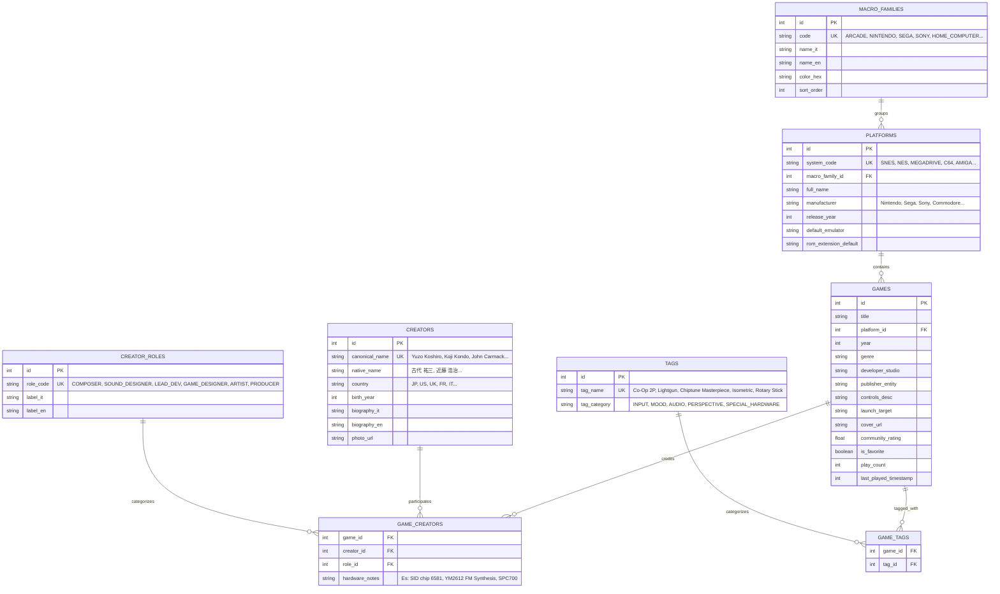

# 🧬 SCHEMA DATABASE, CREDITI D'AUTORE & TASSONOMIA RETROHUB

**Allegato Tecnico Architetturale n. 2**  
* **Autore / Modello AI:** Antigravity (Google DeepMind Team)  
* **Data di Rilascio:** 20 Novembre 2026  
* **Progetto:** RetroHub — Desktop Launcher & Enciclopedia Interattiva del Retrogaming  
* **Collocazione File:** `docs/reports/Antigravity_2026-11-20_Analisi_DB_Piattaforme_RetroHub/SCHEMA_DATABASE_CREDITI_E_TASSONOMIA.md`  

---

## 🏛️ 1. Filosofia Architetturale: L'Enciclopedia Umanistica

La maggior parte dei frontend per emulatori organizza i metadati con un approccio "piatto" a singola tabella:
```
games (id, title, system, year, genre, developer, publisher, rom_path, cover)
```
Questo schema presenta limiti insormontabili quando si desidera creare un'opera enciclopedica di alto profilo culturale:
1. **Perdita dei Creativi Individuali:** I programmatori leggendari (es. *John Carmack, Yu Suzuki, Éric Chahi*) e i compositori iconici (es. *Yuzo Koshiro, Nobuo Uematsu, Koji Kondo, Chris Huelsbeck*) non sono ricercabili né filtrabili.
2. **Duplicazione delle Stringhe:** Inserire "Konami Industry Co., Ltd." o "Capcom Co., Ltd." in migliaia di record consuma memoria e impedisce raggruppamenti per franchise e team.
3. **Mancanza di Mapping Verso le Macro-Famiglie:** I sistemi rimangono dispersi senza una categorizzazione tematica superiore.

RetroHub introduce un'architettura **SQLite 3 relazionale ibrida e ultra-veloce**, compatibile con `rusqlite` e compilabile nativamente in Rust a zero allocazioni ridondanti.

---

## 📐 2. Modello Entità-Relazione (Schema DDL Completo)



---

## 💾 3. Codice DDL SQL per `retro_hub.db`

Il seguente script SQL può essere eseguito come migrazione automatica da Rust (`rusqlite`) all'avvio di RetroHub:

```sql
-- ============================================================================
-- RETROHUB DATABASE SCHEMA MIGRATION: CREATOR CREDITS & MACRO-FAMILIES
-- ============================================================================

-- 1. Macro-Famiglie Canoniche
CREATE TABLE IF NOT EXISTS macro_families (
    id INTEGER PRIMARY KEY AUTOINCREMENT,
    code TEXT NOT NULL UNIQUE,
    name_it TEXT NOT NULL,
    name_en TEXT NOT NULL,
    color_hex TEXT NOT NULL,
    sort_order INTEGER NOT NULL DEFAULT 0
);

-- 2. Piattaforme Hardware
CREATE TABLE IF NOT EXISTS platforms (
    id INTEGER PRIMARY KEY AUTOINCREMENT,
    system_code TEXT NOT NULL UNIQUE,
    macro_family_id INTEGER NOT NULL,
    full_name TEXT NOT NULL,
    manufacturer TEXT NOT NULL,
    release_year INTEGER,
    default_emulator TEXT,
    rom_extension_default TEXT,
    FOREIGN KEY (macro_family_id) REFERENCES macro_families(id) ON DELETE RESTRICT
);

-- 3. Anagrafica Creativi (Autori, Compositori, Programmatori)
CREATE TABLE IF NOT EXISTS creators (
    id INTEGER PRIMARY KEY AUTOINCREMENT,
    canonical_name TEXT NOT NULL UNIQUE,
    native_name TEXT,
    country TEXT,
    birth_year INTEGER,
    bio_it TEXT,
    bio_en TEXT,
    photo_url TEXT
);

-- 4. Ruoli nei Titoli
CREATE TABLE IF NOT EXISTS creator_roles (
    id INTEGER PRIMARY KEY AUTOINCREMENT,
    role_code TEXT NOT NULL UNIQUE,
    label_it TEXT NOT NULL,
    label_en TEXT NOT NULL
);

-- Popolamento Ruoli Standard
INSERT OR IGNORE INTO creator_roles (role_code, label_it, label_en) VALUES
    ('COMPOSER', 'Compositore Colonna Sonora', 'Music Composer'),
    ('SOUND_DESIGNER', 'Sound Designer / Effetti Audio', 'Sound Designer'),
    ('LEAD_DEV', 'Capo Programmatore', 'Lead Programmer'),
    ('GAME_DESIGNER', 'Game Designer / Regista', 'Game Designer / Director'),
    ('LEAD_ARTIST', 'Direttore Artistico / Grafica', 'Lead Artist / Character Designer'),
    ('PRODUCER', 'Produttore Esecutivo', 'Executive Producer'),
    ('HARDWARE_ENG', 'Ingegnere Hardware / Chipmaker', 'Hardware Engineer');

-- 5. Tabella N-a-M: Crediti Gioco-Autore
CREATE TABLE IF NOT EXISTS game_creators (
    game_id INTEGER NOT NULL,
    creator_id INTEGER NOT NULL,
    role_id INTEGER NOT NULL,
    hardware_notes TEXT,
    PRIMARY KEY (game_id, creator_id, role_id),
    FOREIGN KEY (game_id) REFERENCES games(id) ON DELETE CASCADE,
    FOREIGN KEY (creator_id) REFERENCES creators(id) ON DELETE CASCADE,
    FOREIGN KEY (role_id) REFERENCES creator_roles(id) ON DELETE CASCADE
);

-- 6. Tassonomia Tag Sensoriali & Hardware
CREATE TABLE IF NOT EXISTS tags (
    id INTEGER PRIMARY KEY AUTOINCREMENT,
    name TEXT NOT NULL UNIQUE,
    category TEXT NOT NULL -- INPUT, AUDIO, PERSPECTIVE, HARDWARE, MOOD
);

CREATE TABLE IF NOT EXISTS game_tags (
    game_id INTEGER NOT NULL,
    tag_id INTEGER NOT NULL,
    PRIMARY KEY (game_id, tag_id),
    FOREIGN KEY (game_id) REFERENCES games(id) ON DELETE CASCADE,
    FOREIGN KEY (tag_id) REFERENCES tags(id) ON DELETE CASCADE
);

-- Indici di prestazione per query istantanee a 60 FPS
CREATE INDEX IF NOT EXISTS idx_platforms_macro ON platforms(macro_family_id);
CREATE INDEX IF NOT EXISTS idx_game_creators_creator ON game_creators(creator_id);
CREATE INDEX IF NOT EXISTS idx_game_creators_game ON game_creators(game_id);
CREATE INDEX IF NOT EXISTS idx_game_tags_tag ON game_tags(tag_id);
CREATE INDEX IF NOT EXISTS idx_games_platform ON games(platform_id);
```

---

## ⚡ 4. Ricerca Full-Text Instantanea (SQLite FTS5)

Per permettere all'utente di digitare `Koshiro` o `Uematsu` nella barra di ricerca del frontend e vedere apparire istantaneamente le card dei giochi in meno di 2 millisecondi, integriamo SQLite FTS5:

```sql
-- Tabella Virtuale FTS5 per Ricerca Globale Ultra-Veloce
CREATE VIRTUAL TABLE IF NOT EXISTS games_creators_fts USING fts5(
    game_id UNINDEXED,
    title,
    system_code,
    genre,
    developer_studio,
    creator_name,
    role_label,
    content='games',
    tokenize='unicode61 remove_diacritics 2'
);
```

---

## 🦀 5. Esempio di Integrazione Rust (`rusqlite`)

Ecco la funzione Rust idiomatica che recupera i dettagli completi di un gioco includendo i suoi crediti d'autore senza allocazioni superflue:

```rust
use rusqlite::{Connection, Result};
use serde::{Deserialize, Serialize};

#[derive(Debug, Serialize, Deserialize)]
pub struct CreatorCredit {
    pub creator_name: String,
    pub role_label: String,
    pub hardware_notes: Option<String>,
}

#[derive(Debug, Serialize, Deserialize)]
pub struct GameDetailedView {
    pub id: i64,
    pub title: String,
    pub system_code: String,
    pub macro_family_name: String,
    pub year: i32,
    pub genre: String,
    pub developer: String,
    pub credits: Vec<CreatorCredit>,
}

pub fn get_game_with_credits(conn: &Connection, game_id: i64) -> Result<Option<GameDetailedView>> {
    let mut stmt = conn.prepare(
        r#"
        SELECT 
            g.id, g.title, p.system_code, mf.name_it, g.year, g.genre, g.developer
        FROM games g
        JOIN platforms p ON g.platform_id = p.id
        JOIN macro_families mf ON p.macro_family_id = mf.id
        WHERE g.id = ?1
        "#,
    )?;

    let game_opt = stmt.query_row([game_id], |row| {
        Ok((
            row.get::<_, i64>(0)?,
            row.get::<_, String>(1)?,
            row.get::<_, String>(2)?,
            row.get::<_, String>(3)?,
            row.get::<_, i32>(4)?,
            row.get::<_, String>(5)?,
            row.get::<_, String>(6)?,
        ))
    }).optional()?;

    let (id, title, system_code, macro_family_name, year, genre, developer) = match game_opt {
        Some(val) => val,
        None => return Ok(None),
    };

    // Recupera i crediti creativi collegati
    let mut cred_stmt = conn.prepare(
        r#"
        SELECT c.canonical_name, cr.label_it, gc.hardware_notes
        FROM game_creators gc
        JOIN creators c ON gc.creator_id = c.id
        JOIN creator_roles cr ON gc.role_id = cr.id
        WHERE gc.game_id = ?1
        ORDER BY cr.id ASC
        "#,
    )?;

    let credits_iter = cred_stmt.query_map([game_id], |row| {
        Ok(CreatorCredit {
            creator_name: row.get(0)?,
            role_label: row.get(1)?,
            hardware_notes: row.get(2)?,
        })
    })?;

    let mut credits = Vec::new();
    for cred in credits_iter {
        credits.push(cred?);
    }

    Ok(Some(GameDetailedView {
        id,
        title,
        system_code,
        macro_family_name,
        year,
        genre,
        developer,
        credits,
    }))
}
```

---

## 🗺️ 6. Mapping Ufficiale delle 35 Piattaforme nelle 12 Macro-Famiglie

| Macro-Famiglia | Codice Famiglia | Sistemi Accorpati (`system_code`) | Descrizione & Filosofia |
| :--- | :--- | :--- | :--- |
| **1. Arcade Coin-Op** | `ARCADE` | `MAME`, `NEOGEO`, `NAOMI`, `ATOMISWAVE`, `HIKARU` | Il mondo delle sale giochi e dei cabinati con gettoniera dal 1971 a fine anni '90. |
| **2. Laserdisc & FMV** | `LASERDISC` | `HYPSEUS`, `DAPHNE` | Capolavori a cartoni animati interattivi su laserdisc (*Dragon's Lair, Space Ace*). |
| **3. Pinball & Flipper** | `PINBALL` | `PINBALL`, `VPX`, `FUTURE_PINBALL` | Simulazione fisica realistica dei flipper elettromeccanici e a stato solido. |
| **4. LCD & Game & Watch** | `GAMEWATCH` | `GAMEWATCH`, `TIGER` | Schermi a cristalli liquidi e orologi-gioco anni '80 di Gunpei Yokoi. |
| **5. Nintendo Universe** | `NINTENDO` | `NES`, `SNES`, `N64`, `GAMECUBE`, `GB`, `GBC`, `GBA` | L'ecosistema leggendario delle console fisse e tascabili di Kyoto. |
| **6. Sega Universe** | `SEGA` | `MASTERSYSTEM`, `MEGADRIVE`, `SATURN`, `DREAMCAST`, `GAMEGEAR` | La storia arcade-centrica di Sega dall'era 8-bit al Dreamcast. |
| **7. Sony PlayStation** | `SONY` | `PSX`, `PS2`, `PSP` | L'egemonia delle console a CD e DVD di Ken Kutaragi che hanno rivoluzionato l'industria. |
| **8. Atari & Vintage Pioneers** | `VINTAGE` | `ATARI2600`, `ATARI7800`, `INTELLIVISION`, `COLECO`, `VECTREX`, `JAGUAR`, `LYNX` | I pionieri dell'era cartucce pre-1984 e le sfortunate console estreme degli anni '90. |
| **9. SNK & NEC Engine** | `SNK_NEC` | `NEOGEO_CD`, `PCENGINE`, `PCENGINE_CD`, `SUPERGRAFX` | I gioielli della tecnologia giapponese con grafica raster e chip audio CD d'eccellenza. |
| **10. Home Computer Occidentali** | `HOME_PC` | `C64`, `AMIGA`, `DOS`, `SCUMMVM`, `ATARI_ST`, `ZX_SPECTRUM` | La culla dello sviluppo indipendente europeo e delle avventure grafiche su floppy. |
| **11. Nippon Micro Computers** | `NIPPON_PC` | `MSX`, `MSX2`, `X68000`, `PC88`, `PC98`, `FMTOWNS` | Le potenti workstation grafiche giapponesi che hanno ospitato i primi RPG e shoot 'em up. |
| **12. PC Moderno, Recomp & Indie**| `MODERN_PC` | `RECOMP`, `INDIE`, `NATIVE_PC` | Porting ricompilati nativi a 60 FPS, capolavori freeware indipendenti e de-compilazioni. |
